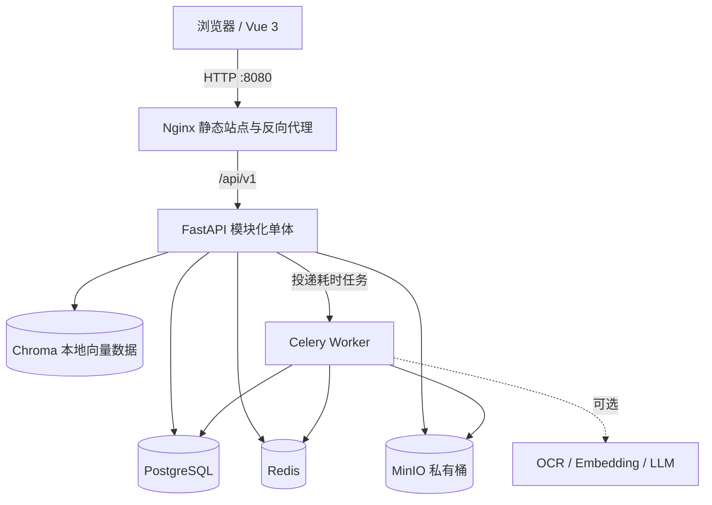

# 智能自适应学习系统

> 本目录是 **Windows 应用版的独立项目**。已生成 `0.2.0-test.1` 本机测试安装包，可双击桌面的“知途（测试版）”使用；安装包位置、功能范围和测试记录见 [测试版说明](docs/DESKTOP_TEST_BUILD.md)。D1 已接通免登录本地空间、受保护本机服务和 Windows 原生窗口。原网页版继续保留在 `E:\项目\学习系统`，不受本目录改动影响。
>
> 应用版开发启动：在 PyCharm 使用应用版 `backend\.venv\Scripts\python.exe`，运行根目录 `run_desktop.py`。无需 Docker，不打开浏览器。准备步骤、数据位置和验收边界见 [桌面 D1 说明](docs/DESKTOP_D1.md)、[版本来源](docs/VERSION_LINEAGE.md) 和 [整体设计](docs/superpowers/specs/2026-10-20-windows-local-app-design.md)。多格式和可选 AI 设置尚待后续批次。

两端已共同纳入[教材内容驱动的补题方案](docs/superpowers/specs/2026-10-20-textbook-question-fill-design.md)：根据导入教材的正文与知识要点生成配套候选，确认后保存到对应教材；不以无教材题库或自由主题出题为目标。此项尚未实现，不能把远程网页误称为断网也能使用。

## 以下为网页版基线参考（不是应用版启动步骤）

网页版基线保存说明见 [网页版版本记录](docs/WEB_BASELINE.md)。以下旧 Web／Docker／账户配置仅供追溯，不适用于桌面运行模式；请勿依此把新应用连接到旧数据目录。

这是一个面向所有自主学习者、以教材为中心的 Web 学习平台工程，采用 Vue 3 + FastAPI + PostgreSQL + Redis + MinIO，并为 PDF 解析、RAG 问答、个人题库、模拟测试、掌握度计算和跨教材知识图谱预留清晰的模块边界。每个学习者拥有彼此隔离的私有教材库，可以自行导入、校对、建题、练习和持续积累学习数据。

当前仓库优先提供可运行的 MVP 和可渐进替换的 AI 接口。默认启动不要求大模型 API Key，也不强制下载体积较大的 OCR/向量模型；当前 RAG 使用可运行的关键词基线，生产级 OCR、向量检索、主观题评分和知识图谱治理按照[路线图](docs/ROADMAP.md)逐步启用。

产品采用单一学习者账户模型。每个账户只管理自己的教材与学习数据；跨教材成长、错题延续和掌握度迁移也只发生在同一账户内部，不读取或合并其他学习者的数据。

## 能力范围

| 模块 | 当前工程目标 | AI 增强方向 |
| --- | --- | --- |
| 账户与私有空间 | 学习者注册、JWT 登录、个人数据隔离 | 数据导出、删除与跨设备同步 |
| 教材管理 | 私有教材、章节、知识点、文件和解析任务 | 目录识别、OCR、知识点/习题结构化与学习者校对 |
| 教材问答 | 文档片段检索、答案与来源引用接口 | BGE 向量化、重排、受约束的 LLM 生成 |
| 题库与测试 | 多题型、组卷、测试记录、自动判客观题 | AI 生成题候选、主观题辅助评分 |
| 自适应学习 | 答题明细、错题、知识点掌握度与薄弱项 | 难度校准、时间衰减、前置知识复习 |
| 成长路径 | 同一学习者的跨教材掌握度与错题延续 | 私有知识图谱、路径推荐与可视化 |

> 重要边界：AI 生成的题目、答案、知识点映射和主观题评分只能作为候选结果，必须保留来源与模型版本，并由教材所属的学习者确认后使用。

## PyCharm 本地启动（无需 Docker）

用 PyCharm 打开项目根目录，选择 **学习系统（本地，不用 Docker）** 后点击运行，
或右键运行根目录的 `run_local.py`。网页地址为 **http://127.0.0.1:8081**。
数据保存在 `data/local/`，与 Docker 数据和旧本地数据库隔离；不要求开启虚拟化。
详细步骤和备份说明见 [本地运行说明](docs/LOCAL_RUN.md)。

## Docker 启动（可选，Windows PowerShell）

前置条件：Docker Desktop 已启动，支持 `docker compose`；建议至少 8 GB 可用内存。默认会占用 `8080`、`8000`、`5432`、`6379`、`9000`、`9001` 端口，可在 `.env` 中修改。

```powershell
Set-Location "E:\项目\学习系统"
Copy-Item .env.example .env
docker compose config --quiet
docker compose up -d --build
docker compose ps
docker compose exec backend python -m app.seed
```

首次构建耗时取决于网络。`backend` 和 `frontend` 显示为 `healthy` 后即可访问：

| 入口 | 地址 |
| --- | --- |
| Web 应用 | <http://localhost:8080> |
| API 文档（Swagger） | <http://localhost:8000/docs> |
| API 健康检查 | <http://localhost:8000/api/v1/health> |
| MinIO 控制台 | <http://localhost:9001> |

macOS/Linux 可将复制命令替换为 `cp .env.example .env`，其余命令相同。

### 本地演示账号

账号不会在服务启动时静默创建。执行上面的幂等 seed 命令后，才会得到以下仅供本地开发使用的账号：

| 账号 | 邮箱 | 初始密码 |
| --- | --- | --- |
| 学习者 | `learner@example.com` | `Learn123!` |

MinIO 的本地账号来自 `.env` 中的 `MINIO_ROOT_USER` / `MINIO_ROOT_PASSWORD`。任何共享、测试或生产部署都必须先替换全部示例密码和 JWT 密钥；不要把 `.env` 提交到 Git。

## 架构



初期采用模块化单体，避免过早拆分服务；PDF/OCR/向量化/大模型调用通过 Celery 与请求链路隔离。MVP 选择本地 Chroma 数据目录，规模或并发达到瓶颈后再通过存储适配器迁移 Milvus。更完整的组件边界、数据流和设计决策见[架构说明](docs/ARCHITECTURE.md)。

### 容器与数据

| Compose 服务 | 用途 | 持久化位置 |
| --- | --- | --- |
| `frontend` | 构建后的 Vue SPA，由 Nginx 提供并代理 API | 镜像内静态资源 |
| `backend` | FastAPI API | `backend_data`（上传临时文件与后续向量索引目录） |
| `worker` | Celery 异步任务 | 与 backend 共享 `backend_data`、模型缓存 |
| `postgres` | 业务主数据 | `postgres_data` |
| `redis` | 缓存、Broker、任务结果 | `redis_data` |
| `minio` / `minio-init` | 私有教材对象与初始化桶 | `minio_data` |

命名卷默认由 Docker 管理。`docker compose down` 保留数据；`docker compose down --volumes` 会永久删除本项目的本地数据库、对象和缓存。

## 目录结构

```text
学习系统/
├─ backend/                 FastAPI、领域模型、任务与测试
├─ frontend/                Vue 3、Pinia、Element Plus 与页面
├─ deploy/
│  └─ nginx.conf            SPA 回退、API 代理、上传与超时配置
├─ docs/
│  ├─ ARCHITECTURE.md       架构、边界、流程与非功能要求
│  └─ ROADMAP.md            分阶段里程碑和验收门槛
├─ .env.example             无密钥的配置模板
├─ docker-compose.yml       本地一体化运行环境
├─ Makefile                 常用命令快捷入口
└─ README.md
```

## 常用运维命令

安装 GNU Make 且已经完成本地前后端依赖安装的环境可运行 `make help`、`make up`、`make logs`、`make test`。Windows 不需要安装 Make，直接使用等价的 PowerShell 命令：

```powershell
# 查看状态 / 日志
docker compose ps
docker compose logs -f --tail=200 backend worker

# 重建应用，不动数据库和对象存储
docker compose up -d --build backend worker frontend

# 停止并保留数据
docker compose down --remove-orphans

# 完全清空本项目的本地 Docker 数据（不可恢复）
docker compose down --volumes --remove-orphans
```

## 本地开发

### 后端

需要 Python 3.10+。不运行 Compose 时，后端默认可使用 SQLite 和 eager Celery，便于单进程开发。

```powershell
Set-Location backend
python -m venv .venv
.\.venv\Scripts\Activate.ps1
python -m pip install -e ".[dev]"
python -m app.seed
uvicorn app.main:app --reload --port 8000
```

若 PowerShell 禁止激活脚本，可不激活，直接运行 `.\.venv\Scripts\python.exe -m pip ...` 和 `.\.venv\Scripts\python.exe -m uvicorn ...`。接入 Compose 的 PostgreSQL/Redis 时，应在当前终端设置对应 URL，且注意容器内主机名 `postgres` / `redis` 在宿主机应改为 `localhost`。

### 前端

需要 Node.js 20+ 和 npm：

```powershell
Set-Location frontend
npm install
npm run dev
```

开发服务器默认访问 <http://localhost:5173>，通过 `VITE_API_BASE_URL` 连接 API。若不走 Vite 代理，请确保后端 `CORS_ORIGINS` 包含该地址。

### 测试与构建检查

```powershell
# 后端
Set-Location backend
python -m pytest

# 前端
Set-Location ..\frontend
npm run typecheck
npm run test
npm run build

# Compose 配置
Set-Location ..
docker compose --env-file .env.example config --quiet
```

## API 使用

业务 API 统一以 `/api/v1` 为前缀，Swagger UI 会从实际代码生成最新契约。典型调用顺序如下：

1. 注册或使用 seed 账号登录，取得 Bearer Token。
2. 学习者在自己的私有教材库中创建教材并上传 PDF。
3. 轮询解析任务，校对章节、知识点、习题并确认映射候选。
4. 按教材或章节练习，也可创建自适应试卷。
5. 交卷后读取成绩、逐题结果、错题和知识点掌握度。
6. 问答请求返回答案以及教材、章节、页码/片段引用。

接口字段以 <http://localhost:8000/docs> 为准。客户端不得依赖数据库内部 ID 的排序，也不得绕过题目确认状态直接使用 LLM 生成内容。

## PDF、OCR 与 RAG 可选配置

默认配置有意保持轻量：数字版 PDF 可用 PyMuPDF 抽取文本；`LLM_PROVIDER=disabled` 时应用应继续提供非生成式功能。要接入模型能力，请在 `.env` 中配置而不是修改源码：

```dotenv
# OpenAI-compatible 服务示例；不要提交真实密钥
LLM_PROVIDER=openai-compatible
LLM_API_URL=https://your-provider.example/v1
LLM_API_KEY=replace-me
LLM_MODEL=your-model-name

EMBEDDING_MODEL=BAAI/bge-large-zh-v1.5
RAG_TOP_K=5
RAG_SCORE_THRESHOLD=0.45
```

注意事项：

- 首次使用中文向量模型会下载较大权重，`model_cache` 卷用于复用缓存；离线环境应预先准备模型并固定版本。
- Chroma 数据位于共享的 `/app/data/chroma`。启用向量化前应确认 worker 与 backend 使用相同的嵌入模型和切分版本。
- 扫描件 OCR 需要在后端镜像中额外安装 PaddleOCR 及系统依赖，然后设置 `OCR_ENABLED=true`。未安装时不要仅修改开关。
- 答案生成必须限定为检索片段，引用至少包含教材、章节、页码或片段 ID；证据不足时返回“不足以回答”，不能补写教材没有的结论。
- 云端模型会把选中的片段发送给第三方。含未授权教材、未成年人个人信息或敏感数据时，应禁用外发，改用获批的本地模型。

## 版权、隐私与安全边界

- 平台不因“学习者上传”自动取得教材传播权。默认对象桶为私有，只向教材所属的学习者提供最小必要片段，不提供整本公开下载。
- 网络题目导入必须记录来源、许可、采集时间和学习者确认状态；无法确认授权的内容不得进入个人题库。
- 答题记录、薄弱知识点、学习画像可能构成个人信息。应支持访问控制、导出、更正、删除、保留期限和审计；涉及未成年人时还应提供适龄说明与监护支持。
- 生产环境必须使用 HTTPS、独立强密钥、受限数据库网络、加密备份、恶意文件扫描、上传大小/类型校验、限流和日志脱敏。
- 不把模型输出当作事实或最终学习评价。生成题、知识映射和主观题评分应进入学习者确认流程，并保存模型、提示词版本和证据。
- `.env.example` 的账号与密码只是本地示例；共享部署前必须全部替换，且不应继续暴露 PostgreSQL、Redis、MinIO API 到公网。

## 常见问题

**端口已被占用**：修改 `.env` 中对应的 `*_PORT`，然后重新执行 `docker compose up -d`。

**backend 一直不健康**：运行 `docker compose logs --tail=200 backend postgres`；优先检查 `DATABASE_URL` 与 `POSTGRES_*` 是否一致。密码含 `@`、`:`、`/` 等字符时，需要在 URL 中进行百分号编码。

**worker 无法连接 Redis**：确认 `REDIS_PASSWORD`、`CELERY_BROKER_URL` 和 `CELERY_RESULT_BACKEND` 使用相同密码，并查看 `docker compose logs worker redis`。

**前端出现 502**：确认 backend 已 healthy；Nginx 在容器网络中通过服务名 `backend:8000` 访问 API，不应改成 `localhost:8000`。

**要重置本地环境**：先导出所需数据，再执行 `docker compose down --volumes --remove-orphans`。该操作会删除本项目的命名卷，无法通过 Compose 恢复。

## 进一步阅读

- [系统架构与关键设计](docs/ARCHITECTURE.md)
- [分阶段实施路线图](docs/ROADMAP.md)
