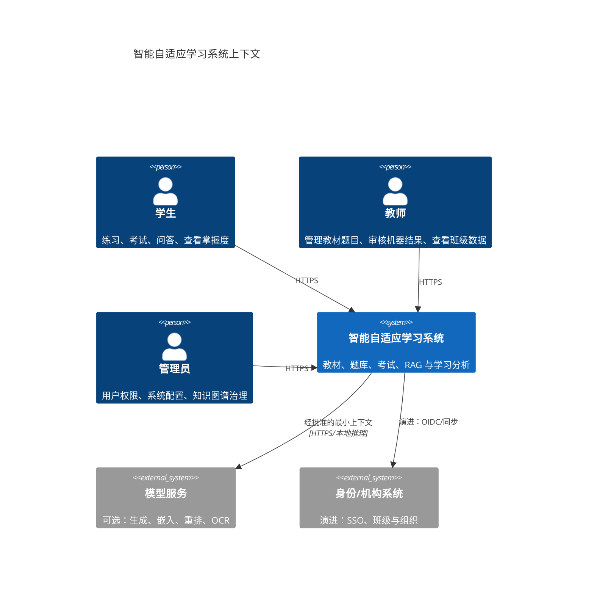
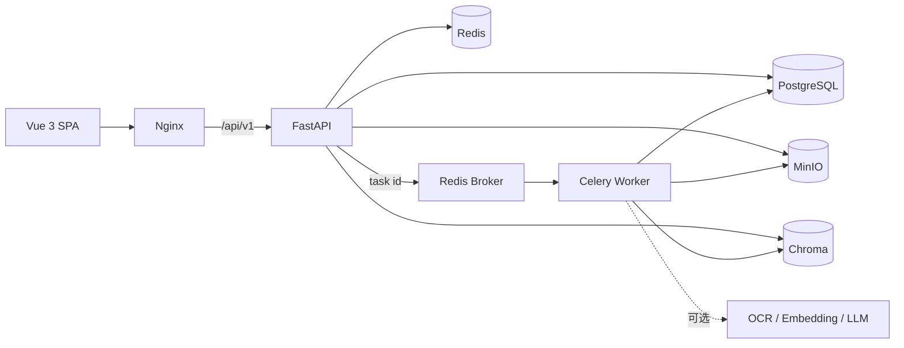
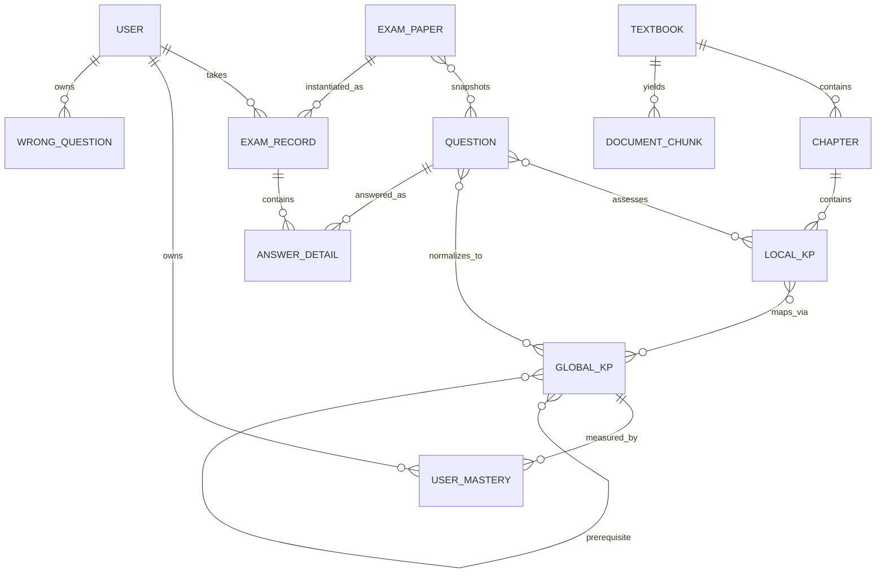
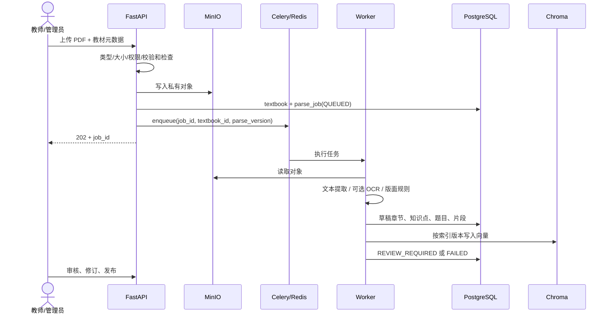
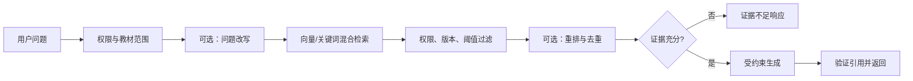

# 系统架构与关键设计

本文描述智能自适应学习系统的目标架构、模块边界和演进约束。它既是当前模块化单体的设计依据，也是后续拆分服务时的边界地图。代码与 OpenAPI 契约是运行行为的最终事实；尚未进入当前迭代的能力在本文中会明确标记为演进目标。

## 1. 设计目标与约束

### 1.1 关键质量属性

1. **可追溯**：教材解析、RAG 回答、生成题和评分都能回到原文件、页码/片段、模型与处理版本。
2. **可审核**：机器产出的章节、知识点、题目和映射在发布前进入人工审核，不覆盖人工修改。
3. **可降级**：LLM、OCR、向量模型不可用时，登录、教材元数据、题库、考试和历史数据仍能工作。
4. **数据隔离**：教材对象、答题数据和学习画像按用户/机构授权；向第三方模型发送上下文需要显式配置。
5. **可演进**：先采用模块化单体和存储适配器，只有容量、团队或故障隔离提出真实需求时才拆分微服务。
6. **可复现**：题目、试卷、掌握度和回答记录所使用的规则、提示词、模型与数据版本必须可查。

### 1.2 非目标

- MVP 不追求对任意复杂排版 PDF 的全自动无误解析。
- MVP 不把全局知识图谱建设成独立图数据库平台。
- 未经审核的 LLM 输出不能直接进入正式题库或成为最终教学评价。
- 系统不提供教材版权授权，也不默认允许公开共享用户上传的教材。

## 2. 系统上下文



## 3. 运行时容器



| 容器 | 职责 | 不应承担的职责 |
| --- | --- | --- |
| Nginx / frontend | 静态资源、SPA 回退、同源 API 代理、上传上限 | 身份判定、业务授权 |
| FastAPI | 鉴权、事务性用例、查询、任务编排、OpenAPI | 长时间 OCR/模型推理 |
| Celery worker | 可重试的解析、向量化、生成和批处理 | 直接向浏览器提供业务 API |
| PostgreSQL | 权威业务记录、状态机、引用元数据 | 存储整本 PDF 二进制、向量近邻检索 |
| Redis | 缓存、限流、任务 Broker/结果 | 唯一的业务事实来源 |
| MinIO | 原始 PDF、封面、解析中间件和导出文件 | 业务权限规则 |
| Chroma | MVP 的片段向量与元数据索引 | 用户、题目、成绩等权威主数据 |

## 4. 模块化单体边界

模块之间通过应用服务和稳定 DTO 协作，不跨模块直接修改表。异步模块以任务 ID、资源 ID 和版本号作为输入，避免把 ORM 对象放进队列。

| 模块 | 拥有的数据 | 对外能力 | 主要依赖 |
| --- | --- | --- | --- |
| Identity | `user`、角色、令牌/审计 | 注册、登录、当前用户、授权判定 | 无业务模块依赖 |
| Textbook | `textbook`、`chapter`、`local_knowledge_point`、解析任务 | 上传、章节树、审核与发布 | Identity、Object Storage |
| Knowledge Graph | `global_knowledge_point`、关系、`kp_mapping` | 映射候选、前置/包含关系、路径查询 | Textbook |
| Question Bank | `question`、选项、知识点关联、审核记录 | CRUD、导入、生成候选、检索 | Textbook、Knowledge Graph |
| Exam | `exam_paper`、题目快照、`exam_record`、`answer_detail` | 组卷、考试会话、交卷、评分 | Question Bank、Identity |
| Learning Analytics | `user_mastery`、错题、学习事件 | 掌握度更新、薄弱项、推荐权重 | Exam、Knowledge Graph |
| RAG | `document_chunk`、索引版本、问答记录和引用 | 入库、检索、受约束生成 | Textbook、Object Storage |

### 4.1 防止边界泄漏的规则

- 试卷保存题目快照；题库后来修订题干或答案，不应改变已开始/已提交的考试。
- `user_mastery` 关联全局知识点；本地知识点通过已确认映射贡献证据，未确认映射不得静默污染历史掌握度。
- RAG 的向量库只保存可重建索引；片段正文、页码、校验和及权限元数据在 PostgreSQL/对象存储有权威记录。
- 删除教材先撤销访问与索引，再按保留策略异步删除对象；不能只删一张数据库记录。
- 模型调用通过统一网关接口，业务模块不直接依赖某家 SDK。

## 5. 核心领域模型



建议所有业务表统一包含：不可变主键、`created_at`、`updated_at`；需要并发编辑的聚合增加 `version`；软删除仅用于确有恢复/审计需求的资源。时间一律按 UTC 存储，在客户端按用户时区显示。

### 5.1 关键状态机

**教材处理**

```text
UPLOADED -> QUEUED -> PARSING -> REVIEW_REQUIRED -> PUBLISHED
                  \-> FAILED ---------> QUEUED (显式重试)
```

- 每次解析生成独立 `parse_version`，人工修订绑定版本。
- 发布动作校验章节树、页码范围、知识点映射和文件访问权限。
- 重新解析产生新草稿，不覆盖已发布版本。

**题目审核**

```text
DRAFT -> IN_REVIEW -> APPROVED -> RETIRED
                    \-> REJECTED -> DRAFT
```

LLM 和网络导入题必须从 `DRAFT` 开始，保存 `source_type`、来源、许可、生成模型/提示词版本、审核人和时间。

**考试记录**

```text
CREATED -> IN_PROGRESS -> SUBMITTED -> GRADED
              |              \-> PARTIALLY_GRADED -> GRADED
              \-> EXPIRED -> SUBMITTED
```

交卷接口必须幂等。服务端时间是倒计时和逾期判定的权威来源；客户端全屏只能改善体验，不能作为防作弊证明。

## 6. 教材导入与解析



### 6.1 解析任务约束

- 以文件 SHA-256、解析器版本和配置散列生成幂等键；重复投递不得生成重复章节/片段。
- 任务分阶段保存进度和错误码，避免只有一条不可诊断的“解析失败”。
- 扫描 PDF 在 OCR 前先抽样检测文本密度；按页批处理，限制并发、CPU、内存和最长运行时间。
- 保留页码与坐标；清理页眉页脚时不能破坏引用定位。
- 解析结果进入草稿区，教师确认后才可被正式题库和面向学生的问答使用。

## 7. RAG 设计

### 7.1 入库管线

1. 按教材发布版本读取规范化正文。
2. 优先沿章节、小节、段落切分，再用递归字符切分控制长度；保留少量重叠。
3. 为片段保存 `textbook_id`、发布版本、章节路径、页码范围、权限域、正文校验和、切分器和嵌入模型版本。
4. 批量嵌入并写入新 `index_version`。
5. 完整性检查通过后原子切换活动索引；旧索引延迟回收。

### 7.2 查询管线



- 检索过滤必须在生成前执行，不能依靠提示词保护越权内容。
- Prompt 要求“仅根据上下文回答”，但它只是第二道防线；最终引用必须能在返回片段中定位。
- 记录检索候选、分数、最终上下文、模型/提示词版本、延迟、Token 量和用户反馈，用于离线评测。
- 对教材原文设置返回长度上限；问答接口不应被用来逐页重构整本教材。

### 7.3 评测门槛

维护经教师确认的中文问题集，至少测量：Recall@K、引用命中率、回答忠实度、拒答准确率、P95 延迟和单问成本。换切分策略、嵌入模型或 Prompt 前后必须在同一数据集对比，不能只凭主观样例上线。

## 8. 组卷、评分与掌握度

### 8.1 约束优先的组卷

组卷先满足硬约束，再优化自适应目标：

1. 题量、总分、题型、章节/知识点范围。
2. 难度分布、重复题间隔、审核状态、版权/可见范围。
3. 薄弱知识点覆盖、前置知识复习、新旧题比例和多样性。

所有随机过程保存 `strategy_version` 与随机种子，使问题可以重放和解释。题目不足时返回明确的不可满足约束，不用未审核题静默补齐。

### 8.2 初始掌握度模型

MVP 采用可解释的时间衰减 EWMA，并把算法封装在版本化策略接口中。对知识点 `k`：

```text
decayed = baseline + (previous - baseline) * exp(-lambda * elapsed_days)
evidence = clamp(correctness + difficulty_adjustment - abnormal_time_penalty, 0, 1)
mastery  = clamp((1 - alpha) * decayed + alpha * evidence, 0, 1)
```

- `correctness`：客观题为 0/1，部分得分题使用 `[0,1]`；未人工确认的主观题不更新正式掌握度。
- `difficulty_adjustment`：答对较难题提高证据、答错简单题降低证据，但调整幅度设置上限。
- `abnormal_time_penalty`：只处理极短作答、超时等异常，不把“更快”简单等价成“掌握更好”。
- `alpha` 随证据质量和题目区分度变化；一题关联多个知识点时按显式权重分配，不重复计算满额证据。
- 保存每次更新前后值、证据和算法版本，支持回放与模型迁移。

下一次抽题对知识点的基础权重可定义为：

```text
weight(k) = (epsilon + (1 - mastery(k))^gamma)
            * prerequisite_gap(k)
            * overdue_factor(k)
```

最终仍需题型、难度、多样性和最大连续弱项题数等约束，避免系统因短期错误形成“只练不会的题”的反馈回路。后续可在数据量足够、完成偏差审计后评估 BKT/IRT，不应在冷启动阶段伪装精确。

## 9. API 与异步契约

- API 前缀为 `/api/v1`；错误体至少包含稳定 `code`、可读 `message`、可选 `details` 和关联请求 ID。
- 列表接口使用明确分页与排序，避免无上限返回教材片段、题目或答题明细。
- 创建长任务返回 HTTP 202、`task_id` 与状态地址；状态查询返回进度、阶段、可重试错误和产物版本。
- `POST /exam-records/{id}/submit`、文件完成确认和任务重试需要幂等键或服务端状态保护。
- API 响应不返回标准答案给进行中的考试，也不返回对象存储内部凭据。
- 删除、发布、审核、映射确认、导出和模型配置变更写入审计事件。

## 10. 安全、隐私与版权

### 10.1 信任边界

- Nginx 只代理，不做最终业务授权；FastAPI 对每个教材、试卷和报告资源执行对象级权限检查。
- 上传文件视为不可信：校验魔数和扩展名、限制大小/页数、随机对象键、恶意文件扫描、隔离解析进程。
- MinIO 桶默认私有。下载使用短期签名 URL 或经过授权的流式接口，日志不记录 URL 中的签名。
- 密码只保存强哈希；JWT 密钥不进入镜像/Git，生产密钥通过密钥管理系统注入并具备轮换方案。
- 外部模型调用默认关闭。启用前确定数据处理地域、保留策略、供应商条款和最小化/脱敏规则。

### 10.2 数据生命周期

| 数据 | 默认原则 |
| --- | --- |
| 原始教材 | 按授权主体隔离；撤销访问后停止检索，按合同/用户请求删除 |
| 解析中间产物 | 短期保留以便诊断，设置自动过期 |
| 答题与掌握度 | 仅教学目的使用；支持导出、更正、删除与保留期 |
| 模型日志 | 不记录完整敏感上下文；独立设置更短保留期 |
| 审计日志 | 防篡改、最小必要字段、受限访问 |

教材内容的技术可访问性不等于传播许可。公开展示、题目导入和模型训练均需单独确认权利基础。

## 11. 可观测性与可靠性

统一使用结构化日志并传播 `request_id`、`task_id`、`user_id`（可哈希）、`textbook_id` 和 `exam_record_id`。不得写入口令、Token、完整答卷或教材正文。

建议指标：

- API：请求率、错误率、P50/P95/P99、数据库连接池、鉴权失败和限流次数。
- 任务：队列深度、排队/执行时长、各阶段失败率、重试次数、死信任务。
- RAG：检索/生成延迟、Token 与费用、拒答率、引用验证失败、用户反馈。
- 考试：交卷成功率、幂等冲突、评分延迟、部分评分积压。
- 存储：PostgreSQL/MinIO/Redis 容量、备份年龄和恢复演练结果。

重试只用于瞬时错误，采用指数退避和随机抖动；无效 PDF、权限错误、配额超限等永久错误直接进入可解释失败状态。所有任务设置超时和最大重试次数。

## 12. 部署与演进

本地 Compose 暴露基础设施端口以便调试。生产部署应：

- 只公开 443，数据库、Redis、MinIO API 和后端内部端口位于私网；
- 固定镜像摘要/版本，执行数据库迁移后再滚动更新；
- PostgreSQL 和对象存储使用独立备份，定期做实际恢复演练；
- API 与 worker 分别扩容，限制 OCR/模型任务并发；
- Chroma 只适用于单机/小规模基线。需要多副本写入、千万级向量或独立运维时，经评测迁移 Milvus；
- 只有当模块在团队归属、扩容、发布节奏或故障隔离上出现明确需求时，才按现有边界拆服务。

优先拆分候选通常是耗资源的 Document Processing/RAG Worker，而不是事务关联紧密的 Exam 与 Learning Analytics。

## 13. 主要设计决策

| 决策 | 选择 | 理由 | 复审触发条件 |
| --- | --- | --- | --- |
| 应用形态 | 模块化单体 | 降低早期分布式事务和运维成本 | 团队/容量/发布隔离形成真实瓶颈 |
| 异步执行 | Celery + Redis | Python 生态成熟，适合 PDF/OCR/LLM | 需要复杂工作流、事件流或超高吞吐 |
| 主数据库 | PostgreSQL | 事务、约束、JSON 与检索能力均衡 | 无计划替换 |
| 对象存储 | S3 兼容 MinIO | 本地与云端接口一致，避免大文件入库 | 生产选择托管 S3/OSS 时替换适配器 |
| MVP 向量库 | Chroma | 部署简单、适合验证检索质量 | 多机写入、容量/可用性目标提升 |
| 掌握度 | 可解释衰减 EWMA | 冷启动可用、可回放、便于教师理解 | 证据量足够且 BKT/IRT 离线评测显著更优 |
| AI 内容 | 候选 + 人审 | 控制幻觉、版权和教学风险 | 高质量评测也不能取消高风险内容审核 |
